# oisac-datasets

**Open data for opportunistic rain sensing.** Weather can be read from radio links that
were built for something else (cellular backhaul, community and smart-city mesh networks,
satellite TV), and from citizens' weather stations. This repository is a map of the data
that exist for it: **29 datasets** from 12 countries and one pan-European product, each with a page, a picture, a link,
and a one-line command that downloads it, or a small split of it.

It started as the dataset list of the OISAC course lecture *Open datasets for
opportunistic sensing* (Tel Aviv University) and grew from there.

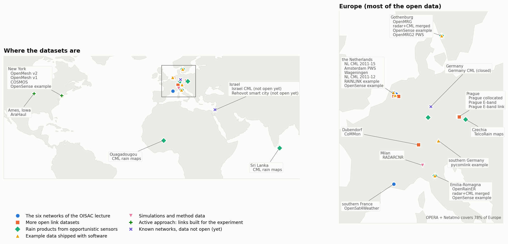

| | |
|---|---|
| **23 open, downloadable** | Zenodo, 4TU.ResearchData and GitHub, fetched by the tool |
| **3 by hand** | COSMOS (ask the testbed), AraHaul (free IEEE DataPort account), OpenMRG2 PWS (notebook with a Drive link) |
| **3 not open** | Israel and Rehovot (TAU, being prepared for release) and the German network (operator agreement) |
| **216 MB** | what the default splits of all open datasets take on disk, against about 90 GB for the full records |

## Quick start

```bash
git clone git@github.com:drorjac/oisac-datasets.git && cd oisac-datasets
pip install -e .                                   # requests, pyyaml, xarray, netCDF4, matplotlib

python -m oisac_datasets list                      # the catalogue, by group
python -m oisac_datasets info openmrg              # one entry
python -m oisac_datasets files netherlands         # the files of a record and their sizes
python -m oisac_datasets contents openmesh openmesh-2.0.0.zip   # what is inside a zip, over HTTP

python -m oisac_datasets fetch openmrg             # the small split (default)
python -m oisac_datasets fetch open                # the split of every open dataset
python -m oisac_datasets fetch opensat4weather --all              # the whole record, resumable, md5-checked
python -m oisac_datasets fetch netherlands --zip RawCMLdata.zip --member "*2012*"   # chosen members only

python -m oisac_datasets figures                   # draw docs/fig/ from what you downloaded
python -m oisac_datasets docs                      # rebuild docs/datasets/*.md and the tables below
```

Data go to `~/data/oisac-datasets/<id>/` (set `OISAC_DATA` to move them), never into the
repository. In Python: `from oisac_datasets import get, fetch; fetch(get("openrainer"))`.

## The landscape

<p>
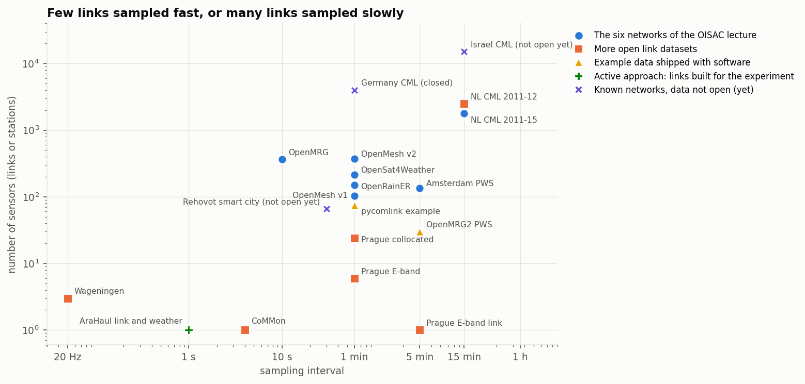
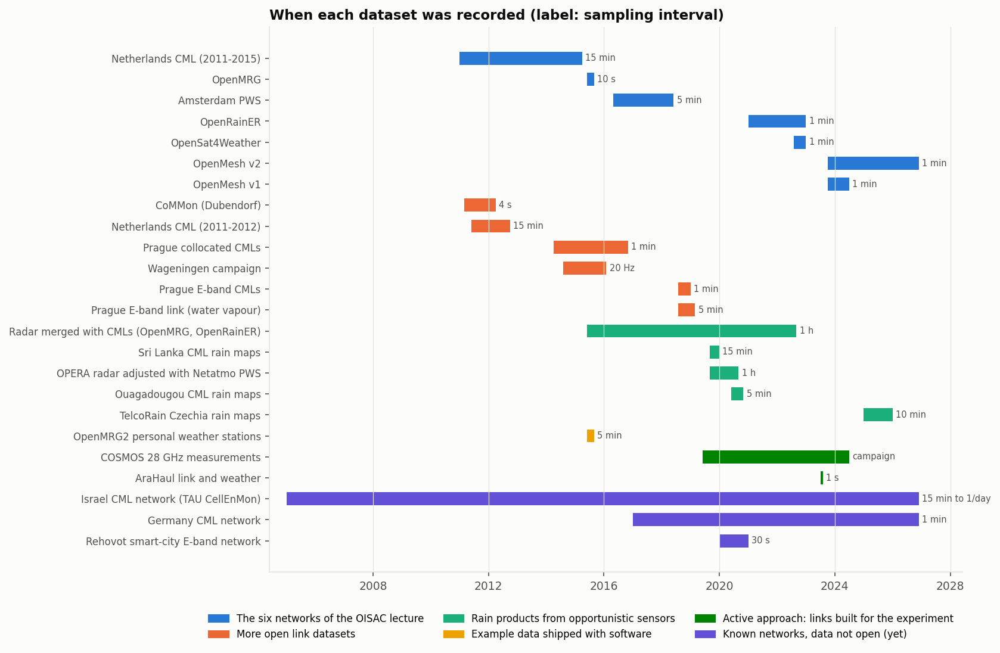
</p>

Opportunistic data come in two shapes: a few links sampled fast (research links, campaigns,
seconds or faster) or many links sampled slowly (operator archives, 15 min min/max). The
open sets cover 2011 to today; the largest networks (Israel, Germany) are not open yet.

## What the splits look like

Every picture below is drawn from the default split, so it is what you get after
`fetch <id>` and `figures`. Click one for the dataset page.

<!-- GALLERY START -->
<table>
<tr><td width="33%" valign="top"><a href="docs/datasets/openmrg.md">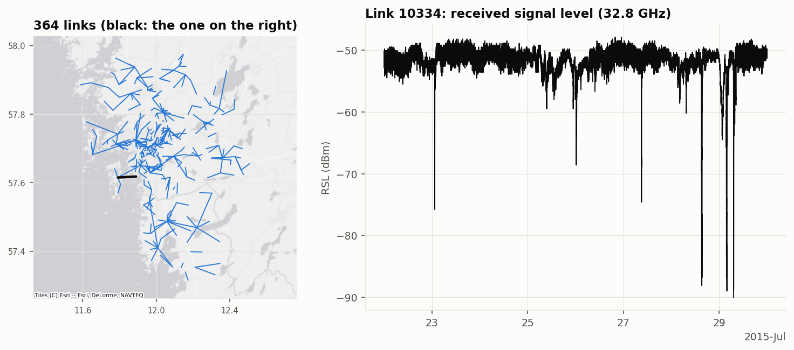</a><br><sub><b>OpenMRG</b></sub></td><td width="33%" valign="top"><a href="docs/datasets/openrainer.md">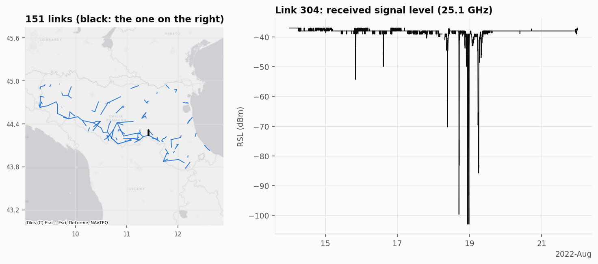</a><br><sub><b>OpenRainER</b></sub></td><td width="33%" valign="top"><a href="docs/datasets/netherlands.md">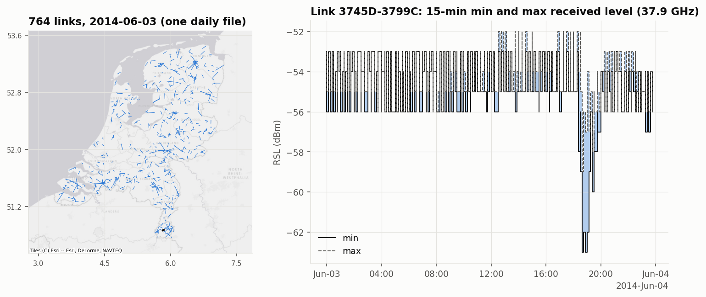</a><br><sub><b>Netherlands CML (2011-2015)</b></sub></td></tr>
<tr><td width="33%" valign="top"><a href="docs/datasets/opensat4weather.md">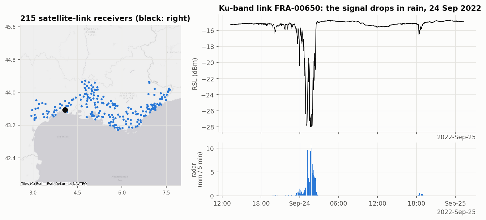</a><br><sub><b>OpenSat4Weather</b></sub></td><td width="33%" valign="top"><a href="docs/datasets/amsterdam_pws.md">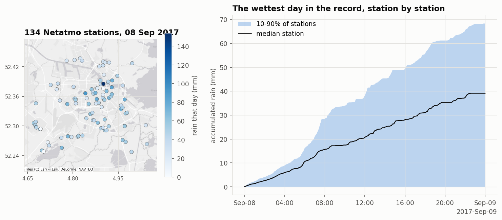</a><br><sub><b>Amsterdam PWS</b></sub></td><td width="33%" valign="top"><a href="docs/datasets/openmesh.md">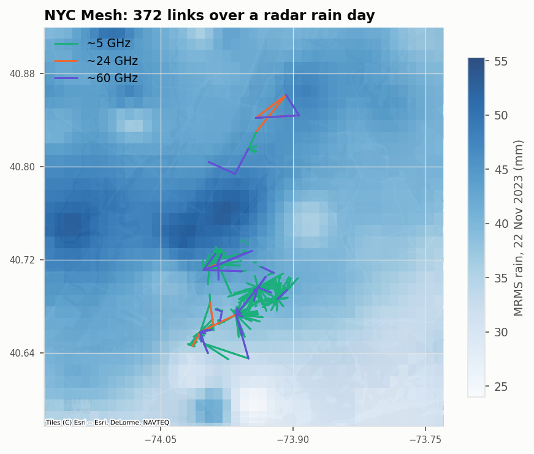</a><br><sub><b>OpenMesh v2</b></sub></td></tr>
<tr><td width="33%" valign="top"><a href="docs/datasets/openmesh_v1.md">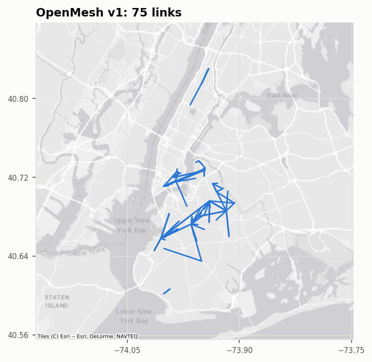</a><br><sub><b>OpenMesh v1</b></sub></td><td width="33%" valign="top"><a href="docs/datasets/prague_eband.md">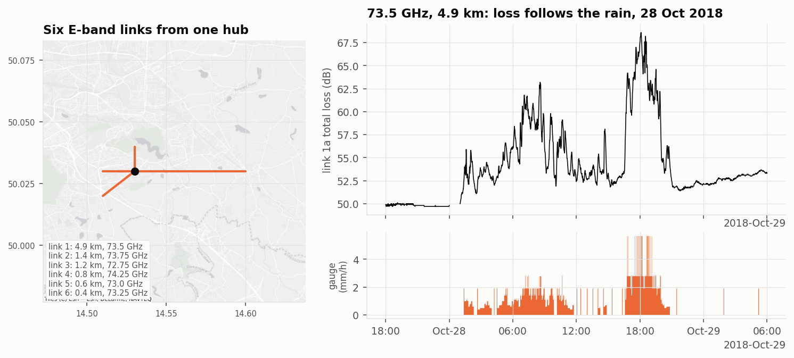</a><br><sub><b>Prague E-band CMLs</b></sub></td><td width="33%" valign="top"><a href="docs/datasets/nl_2011_12.md">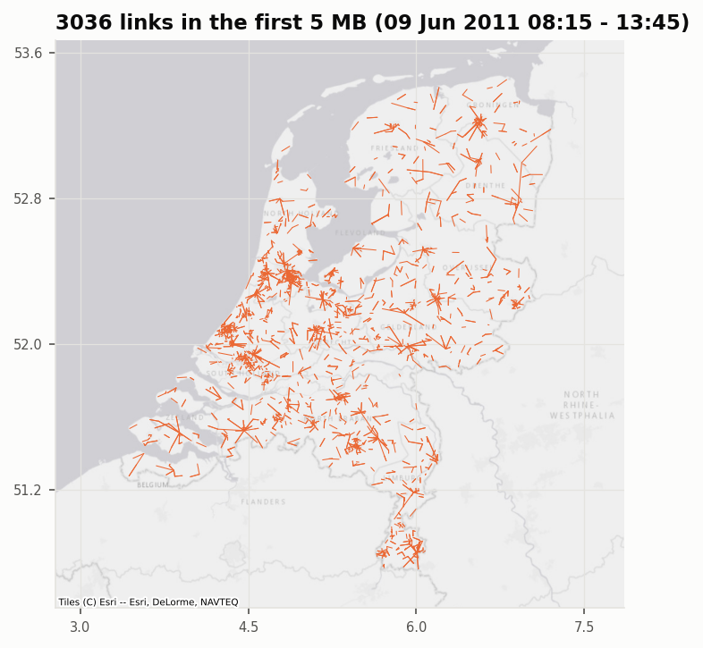</a><br><sub><b>Netherlands CML (2011-2012)</b></sub></td></tr>
<tr><td width="33%" valign="top"><a href="docs/datasets/ouagadougou.md">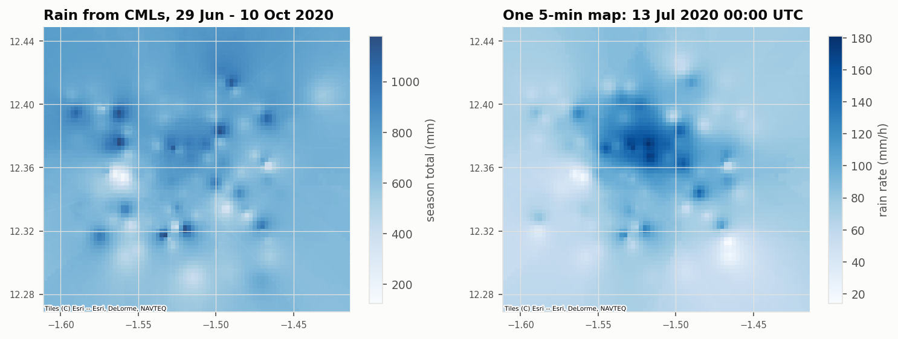</a><br><sub><b>Ouagadougou CML rain maps</b></sub></td><td width="33%" valign="top"><a href="docs/datasets/telcorain_cz.md">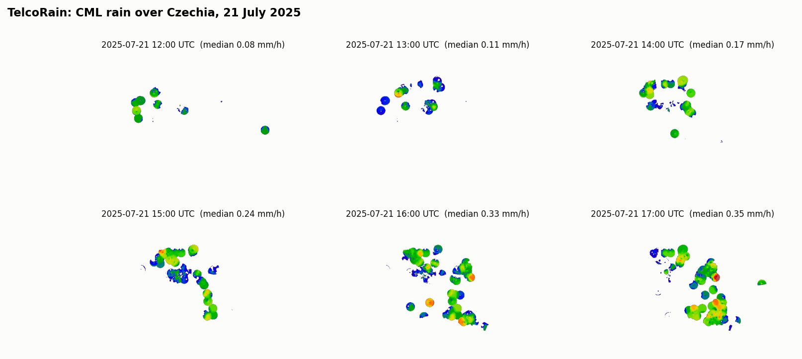</a><br><sub><b>TelcoRain Czechia rain maps</b></sub></td><td width="33%" valign="top"><a href="docs/datasets/radar_cml_merged.md">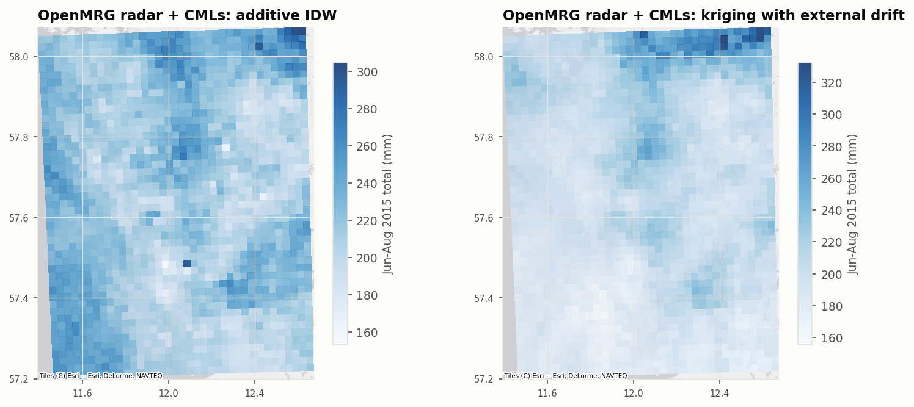</a><br><sub><b>Radar merged with CMLs (OpenMRG, OpenRainER)</b></sub></td></tr>
<tr><td width="33%" valign="top"><a href="docs/datasets/opera_netatmo.md">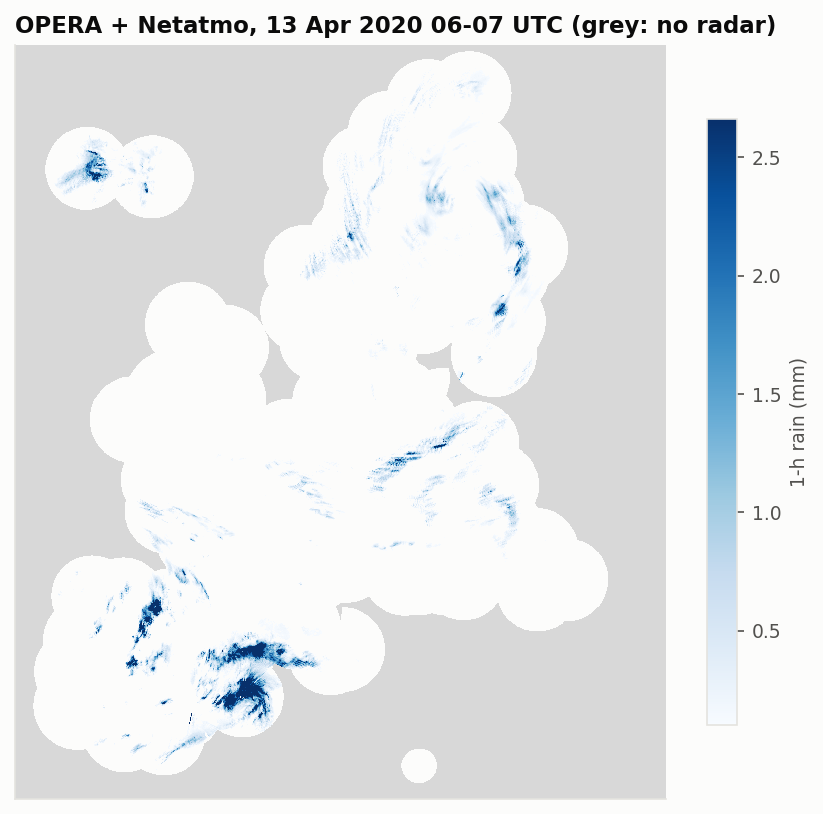</a><br><sub><b>OPERA radar adjusted with Netatmo PWS</b></sub></td><td width="33%" valign="top"><a href="docs/datasets/pycomlink_example.md">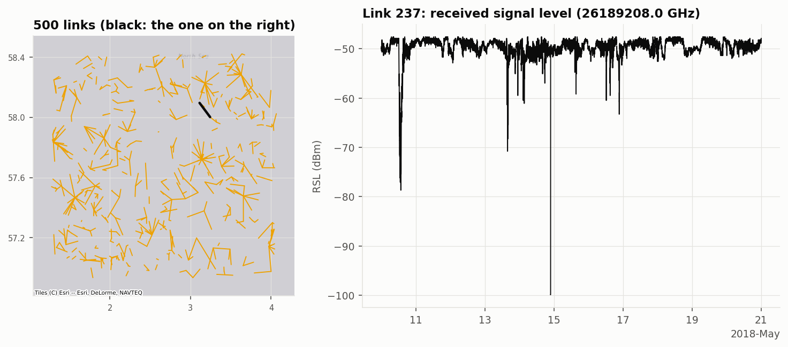</a><br><sub><b>pycomlink example data</b></sub></td><td width="33%" valign="top"><a href="docs/datasets/opensense_example.md">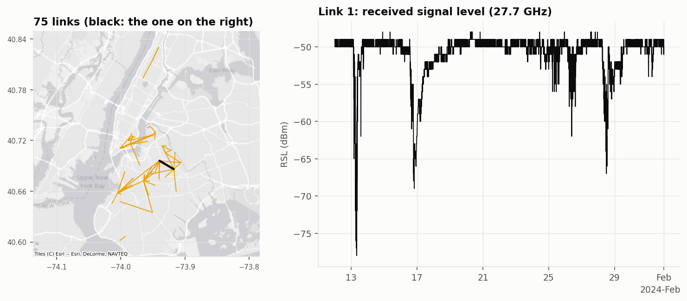</a><br><sub><b>OpenSense example data</b></sub></td></tr>
</table>
<!-- GALLERY END -->

## The datasets

Each name links to its page: facts, citation, files and sizes, what is inside the zip, and
a description of every file in the split (netCDF dimensions and variables, table columns).

<!-- TABLE START (python -m oisac_datasets docs) -->
### The six networks of the OISAC lecture

| dataset | sensor | where | when | sampling | access | licence |
|---|---|---|---|---|---|---|
| [**OpenMRG**](docs/datasets/openmrg.md) | CML | Gothenburg, Sweden | Jun-Aug 2015 | 10 s | [download (Zenodo)](https://doi.org/10.5281/zenodo.7107689) | CC BY-SA 4.0 |
| [**OpenRainER**](docs/datasets/openrainer.md) | CML | Emilia-Romagna, Italy | 2021-2022 | 1 min | [download (Zenodo)](https://doi.org/10.5281/zenodo.10593848) | CC BY 4.0 |
| [**Netherlands CML (2011-2015)**](docs/datasets/netherlands.md) | CML | the Netherlands | Jan 2011 - Mar 2015 | 15 min (min/max RSL) | [download (4TU)](https://doi.org/10.4121/be252844-b672-471e-8d69-27269a862ec1.v1) | CC BY 4.0 |
| [**OpenSat4Weather**](docs/datasets/opensat4weather.md) | SML | southern France | Aug-Dec 2022 | 1 min | [download (Zenodo)](https://doi.org/10.5281/zenodo.16530166) | CC BY 4.0 |
| [**Amsterdam PWS**](docs/datasets/amsterdam_pws.md) | PWS | Amsterdam, the Netherlands | May 2016 - May 2018 | 5 min | [download (4TU)](https://doi.org/10.4121/uuid:6e6a9788-49fc-4635-a43d-a2fa164d37ec) | CC BY 4.0 |
| [**OpenMesh v2**](docs/datasets/openmesh.md) | CML (community mesh) | New York City, USA | Oct 2023 - Nov 2026, yearly updates | 1 min, later 6 min | [download (Zenodo)](https://doi.org/10.5281/zenodo.23283445) | CC BY 4.0 |
| [**OpenMesh v1**](docs/datasets/openmesh_v1.md) | CML (community mesh) | New York City, USA | Oct 2023 - Jun 2024 | 1 min | [download (Zenodo)](https://doi.org/10.5281/zenodo.15287692) | CC BY 4.0 |

### More open link datasets

| dataset | sensor | where | when | sampling | access | licence |
|---|---|---|---|---|---|---|
| [**Wageningen campaign**](docs/datasets/wageningen.md) | CML (research links) | Wageningen, the Netherlands | Aug 2014 - Jan 2016 | 20 Hz | [download (4TU)](https://doi.org/10.4121/uuid:1dd45123-c732-4390-9fe4-6e09b578d4ff) | CC0 |
| [**Prague collocated CMLs**](docs/datasets/prague_collocated.md) | CML (processed) | Prague, Czech Republic | 2014-2016, non-winter | 1 min | [download (Zenodo)](https://doi.org/10.5281/zenodo.8009877) | CC BY 4.0 |
| [**Prague E-band CMLs**](docs/datasets/prague_eband.md) | CML (E-band) | Prague, Czech Republic | Aug-Dec 2018 | 1 min | [download (Zenodo)](https://doi.org/10.5281/zenodo.4090953) | CC BY 4.0 |
| [**Prague E-band link (water vapour)**](docs/datasets/prague_eband_link.md) | CML (E-band) | Prague, Czech Republic | 7 months | 5 min | [download (Zenodo)](https://doi.org/10.5281/zenodo.5013463) | CC BY 4.0 |
| [**CoMMon (Dubendorf)**](docs/datasets/common_dubendorf.md) | CML (dual-pol.) | Dubendorf, Switzerland | Mar 2011 - Mar 2012 | 4 s | [download (Zenodo)](https://doi.org/10.5281/zenodo.4923125) | CC BY 4.0 |
| [**Netherlands CML (2011-2012)**](docs/datasets/nl_2011_12.md) | CML | the Netherlands | Jun 2011 - Sep 2012 | 15 min (min/max RSL) | [download (4TU)](https://doi.org/10.4121/7a692e36-c32f-4916-813b-c62d2566e8d8) | CC BY 4.0 |

### Rain products from opportunistic sensors

| dataset | sensor | where | when | sampling | access | licence |
|---|---|---|---|---|---|---|
| [**Ouagadougou CML rain maps**](docs/datasets/ouagadougou.md) | CML product (maps) | Ouagadougou, Burkina Faso | Jun-Oct 2020 | 5 min, 0.55 km grid | [download (Zenodo)](https://doi.org/10.5281/zenodo.8032918) | CC BY 4.0 |
| [**Sri Lanka CML rain maps**](docs/datasets/srilanka.md) | CML product (maps) | Sri Lanka | Sep-Dec 2019 | 15 min, 0.02 deg grid | [download (4TU)](https://doi.org/10.4121/14166539) | CC BY 4.0 |
| [**TelcoRain Czechia rain maps**](docs/datasets/telcorain_cz.md) | CML product (images) | Czech Republic | 2025 | 10 min | [download (Zenodo)](https://doi.org/10.5281/zenodo.18349080) | CC BY 4.0 |
| [**Radar merged with CMLs (OpenMRG, OpenRainER)**](docs/datasets/radar_cml_merged.md) | CML + radar product | Gothenburg, Sweden and Emilia-Romagna, Italy | summer 2015 and summer 2022 | 1 h, 1-2 km grid | [download (Zenodo)](https://doi.org/10.5281/zenodo.23367571) | CC BY-SA 4.0 |
| [**OPERA radar adjusted with Netatmo PWS**](docs/datasets/opera_netatmo.md) | PWS + radar product | Europe (78% of its area) | Sep 2019 - Aug 2020 | 1 h | [download (4TU)](https://doi.org/10.4121/675f3f64-04a8-48db-ae3e-4a6c004a0776.v2) | CC BY 4.0 |

### Example data shipped with software

| dataset | sensor | where | when | sampling | access | licence |
|---|---|---|---|---|---|---|
| [**pycomlink example data**](docs/datasets/pycomlink_example.md) | CML | Germany | example days | 1 min | [download (GitHub)](https://github.com/pycomlink/pycomlink/tree/master/pycomlink/io/example_data) | BSD-3-Clause (repository) |
| [**RAINLINK example data**](docs/datasets/rainlink_example.md) | CML | the Netherlands | example days | 15 min (min/max RSL) | [download (GitHub)](https://github.com/overeem11/RAINLINK) | GPL-3 (RAINLINK package) |
| [**OpenSense example data**](docs/datasets/opensense_example.md) | CML, PWS, gauges, radar | Gothenburg, Emilia-Romagna, Amsterdam, New York City | 8-20 day subsets | as in the source sets | [download (GitHub)](https://github.com/OpenSenseAction/opensense_example_data) | as in the source sets |
| [**OpenMRG2 personal weather stations**](docs/datasets/openmrg2_pws.md) | PWS | Gothenburg, Sweden | Jun-Aug 2015 | 5 min | [by hand](https://github.com/OpenSenseAction/OpenMRG2) | BSD-3-Clause (code); data preview |

### Simulations and method data

| dataset | sensor | where | when | sampling | access | licence |
|---|---|---|---|---|---|---|
| [**Microwave link simulation dataset**](docs/datasets/mwlink_simulation.md) | simulated CML | (simulated from a Parsivel disdrometer record) | simulation | as the disdrometer | [download (Zenodo)](https://doi.org/10.5281/zenodo.7646651) | CC BY 4.0 |
| [**RADARCNR (Milan)**](docs/datasets/radarcnr.md) | radar + CML configuration | Milan, Italy | rain events | radar scans | [download (Zenodo)](https://doi.org/10.5281/zenodo.3975497) | CC BY 4.0 |

### Active approach: links built for the experiment

| dataset | sensor | where | when | sampling | access | licence |
|---|---|---|---|---|---|---|
| [**COSMOS 28 GHz measurements**](docs/datasets/cosmos.md) | mmWave channel measurements (testbed) | West Harlem, New York City, USA | 2019 (street level), 2022-2024 (outdoor to indoor) | campaign | [by hand](https://wiki.cosmos-lab.org/wiki/Datasets) | see the source |
| [**AraHaul link and weather**](docs/datasets/arahaul.md) | CML (research link) + weather | Ames, Iowa, USA | 4-5 Jul 2023 (link runs), 48 h weather | 1 s | [by hand](https://doi.org/10.21227/6ncx-rs20) | CC BY 4.0 |

### Known networks, data not open (yet)

| dataset | sensor | where | when | sampling | access | licence |
|---|---|---|---|---|---|---|
| [**Israel CML network (TAU CellEnMon)**](docs/datasets/israel_tau.md) | CML | Israel | 2005- | 15 min to 1/day (five protocols) | [not open](https://cellenmonlab.tau.ac.il) | not open yet (being prepared for release) |
| [**Rehovot smart-city E-band network**](docs/datasets/rehovot_scwn.md) | CML (smart-city x-haul) | Rehovot, Israel | 2020 | 30 s | [not open](https://cellenmonlab.tau.ac.il) | not open yet |
| [**Germany CML network**](docs/datasets/germany_cml.md) | CML | Germany | 2017- (operational archive) | 1 min | [not open](https://www.imk-ifu.kit.edu/) | not open (operator agreement) |

<!-- TABLE END -->

## How the split works

Most records are one large zip (OpenMRG 318 MB, OpenMesh 606 MB, the Netherlands 12.6 GB,
a month of OPERA + Netatmo 1.5 GB). Zenodo and 4TU.ResearchData answer HTTP range
requests, so the tool opens such a zip **remotely**: it reads the zip's table of contents
and pulls out single members with a few small requests (`oisac_datasets/remote.py`). The
default split of each dataset (in `catalog.yaml`) is its README and metadata, one or a few
data files, a single radar hour or rain day, or the OpenSense 8-day example subset, which
is already in the [OpenSense data format](https://github.com/OpenSenseAction/OS_data_format_conventions).

## Add a dataset

Add an entry to [`catalog.yaml`](catalog.yaml): a `source` (Zenodo record, 4TU article,
GitHub folder, a page for a manual download, or `closed`), a `sample` (what the split
holds), and `lat`/`lon`, `start`/`end`, `res_s`, `n` for the figures. Then run
`fetch <id>`, `figures` (add a `ql_<id>` function in `oisac_datasets/viz.py` for its
picture), `docs`, and `pytest`.

## Cite the data you use

Each page gives the paper and the data DOI: cite both, and keep to each record's licence
(most are CC BY 4.0; OpenMRG and the merged radar fields are CC BY-SA 4.0; Wageningen is
CC0). The Weather Underground stations inside the OpenMesh v1 record are listed but never
previewed here.

## Related

- OpenSense COST Action CA20136: <https://opensenseaction.eu>, code and conventions at <https://github.com/OpenSenseAction>
- Processing software: [pycomlink](https://github.com/pycomlink/pycomlink), [RAINLINK](https://github.com/overeem11/RAINLINK),
  [poligrain](https://github.com/OpenSenseAction/poligrain), [mergeplg](https://github.com/OpenSenseAction/mergeplg),
  [pypwsqc](https://github.com/OpenSenseAction/pypwsqc), [TelcoRain](https://github.com/TelcoSense/telcorain)
- OpenMesh: <https://github.com/drorjac/OpenMesh> · TAU CellEnMon lab: <https://cellenmonlab.tau.ac.il>

Code: MIT licence. The data are not in this repository and keep their own licences. Base
maps: Natural Earth (overview) and Esri World Gray Canvas (dataset pictures).
