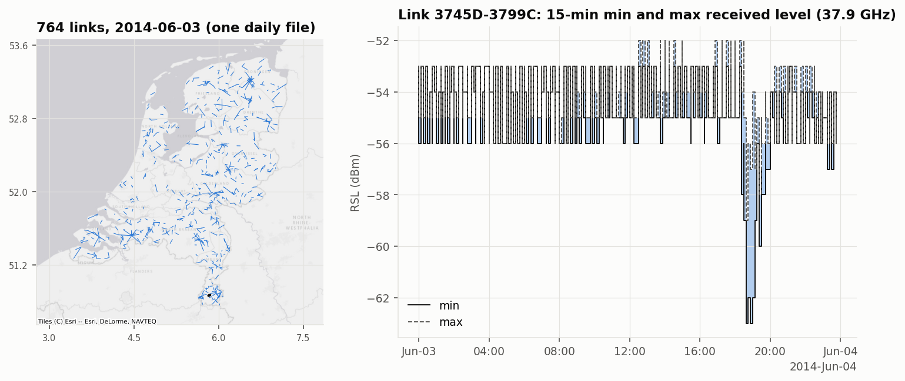

# Netherlands CML (2011-2015)

*The six networks of the OISAC lecture* · `netherlands`

| | |
|---|---|
| Sensor | CML |
| Region | the Netherlands |
| Period | Jan 2011 - Mar 2015 |
| Resolution | 15 min (min/max RSL) |
| Content | about 1800 paths, 3070 sub-links of one operator; RAINLINK format |
| Operator / source | T-Mobile NL (now Odido) |
| Licence | CC BY 4.0 |
| Paper | Overeem et al. (2024), 4TU.ResearchData, [doi:10.4121/be252844-b672-471e-8d69-27269a862ec1.v1](https://doi.org/10.4121/be252844-b672-471e-8d69-27269a862ec1.v1) |
| Data | [https://doi.org/10.4121/be252844-b672-471e-8d69-27269a862ec1.v1](https://doi.org/10.4121/be252844-b672-471e-8d69-27269a862ec1.v1) |

**Links:** [code](https://github.com/overeem11/RAINLINK)



*Drawn from the downloaded split by `python -m oisac_datasets figures`.*

## Get it

```bash
python -m oisac_datasets fetch netherlands            # the small split below
python -m oisac_datasets fetch netherlands --all      # the whole record
```

Split: README, the conversion script and two daily files from inside the 12.6 GB zip (2902 files; read over HTTP, the zip is not downloaded).

## Files in the record

| file | size |
|---|---:|
| `README.pdf` | 11.4 MB |
| `IDRawCMLdata.zip` | 9.5 GB |
| `RawCMLdata.zip` | 12.6 GB |
| `RawCML_to_RAINLINKFormat.R` | 10.2 kB |
| **total** | **22.1 GB** |

## Inside `RawCMLdata.zip` (read over HTTP)

2902 members, 12.6 GB unpacked; 2902 x .gz
- `RawCMLdata/2015/NEC_1-25-2015.csv.gz` (133 B)
- `RawCMLdata/2015/NEC_2-5-2015.csv.gz` (132 B)
- `RawCMLdata/2015/NOKIA_FH_3-7-2015.csv.gz` (1.2 MB)
- `RawCMLdata/2015/NEC_2-6-2015.csv.gz` (132 B)
- `RawCMLdata/2015/NEC_1-28-2015.csv.gz` (133 B)
- `RawCMLdata/2015/NEC_1-14-2015.csv.gz` (133 B)
- `RawCMLdata/2015/NEC_3-5-2015.csv.gz` (132 B)
- `RawCMLdata/2015/NEC_1-2-2015.csv.gz` (132 B)
- `RawCMLdata/2015/NOKIA_FH_2-13-2015.csv.gz` (1.4 MB)
- `RawCMLdata/2015/NEC_1-24-2015.csv.gz` (133 B)
- `RawCMLdata/2015/NOKIA_FH_1-23-2015.csv.gz` (1.5 MB)
- `RawCMLdata/2015/NEC_2-12-2015.csv.gz` (133 B)
- ... 2890 more (full list: `_zip_contents.tsv` after a fetch)

## What the split holds

**`README.pdf`** (11.4 MB)

**`RawCML_to_RAINLINKFormat.R`** (10.2 kB)

```
# R script "RawCML_to_RAINLINKFormat.R"
# Author: Aart Overeem (Royal Netherlands Meteorological Institute)
# Date: June 2024
# Description: converts raw commercial microwave link (CML) data as obtained from mobile network operator T-Mobile NL, nowadays called Odido, to data in a forma
# rainfall retrieval and mapping by software package RAINLINK (https://github.com/overeem11/RAINLINK).
#
```

**`RawCMLdata/RawCMLdata/2014/NOKIA_FH_6-3-2014.csv.gz`** (2.9 MB)

```
LINK_ID,SITE_ID,SITE_LAT_SECS,SITE_LON_SECS,FAR_END_SITE_ID,FAR_END_LAT_SECS,FAR_END_LON_SECS,FREQ,YYYYMMDDHHMMSS,NAME,PERIOD_DURATION,ERR_SEC,ERR_SEC_SEVERE,RF
4106E-4110A,4106E,187307734,19913674,4110A,187349596,19953458,38003000,20140603000000,4106-4110#1,15,10,0,-50,-49
7062D-4427K,7062D,187050360,21542195,4427K,187067629,21606149,39245500,20140603000000,7062-4427#1,15,845,0,-41,-41
7264A-4033D,4033D,187504650,20156030,7264A,187456506,20257804,37912000,20140603000000,4033-7264#1,15,0,0,-52,-52
7350A-7370C,7350A,186942520,21970117,7370C,186993678,21851768,38059000,20140603000000,7350-7370#1,15,0,0,-48,-47
4424A-7375E,4424A,186742904,22955195,7375E,186770663,22961830,37912000,20140603000000,FlexiHopper,15,0,0,-48,-47
```

**`RawCMLdata/RawCMLdata/2015/NOKIA_FH_3-7-2015.csv.gz`** (1.2 MB)

```
LINK_ID,SITE_ID,SITE_LAT_SECS,SITE_LON_SECS,FAR_END_SITE_ID,FAR_END_LAT_SECS,FAR_END_LON_SECS,FREQ,YYYYMMDDHHMMSS,NAME,PERIOD_DURATION,ERR_SEC,ERR_SEC_SEVERE,RF
5357B-5372C,5372C,190780112,24993620,5357B,191105932,25476581,18030000,20150307000000,5372-5357#1,15,0,0,-59,-59
7580B-7581B,7581B,190006697,21940084,7580B,189795620,21889108,26390000,20150307000000,7581-7580#1,15,0,0,-50,-49
5450C-5375D,5450C,190758085,25032492,5375D,190719803,25127254,39256000,20150307000000,FlexiHopper,15,0,0,-57,-56
7603C-5376A,7603C,190493755,25014217,5376A,190546411,25254899,39165000,20150307000000,7603-5376#1,15,0,0,-45,-45
5006A-5002C,5006A,189957636,20737494,5002C,189755434,20703146,26390000,20150307000000,5006-5002#1,15,0,0,-52,-52
```

