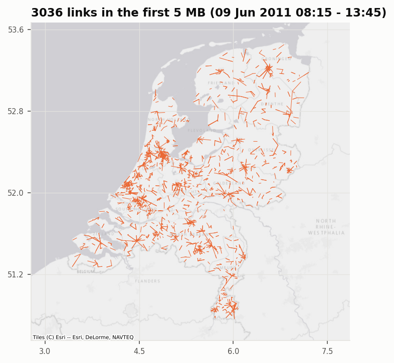

# Netherlands CML (2011-2012)

*More open link datasets* · `nl_2011_12`

| | |
|---|---|
| Sensor | CML |
| Region | the Netherlands |
| Period | Jun 2011 - Sep 2012 |
| Resolution | 15 min (min/max RSL) |
| Content | the first RAINLINK release, about 2500 links |
| Licence | CC BY 4.0 |
| Paper | Overeem et al. (2016), AMT 9, 2425-2444, [doi:10.5194/amt-9-2425-2016](https://doi.org/10.5194/amt-9-2425-2016) |
| Data | [https://doi.org/10.4121/7a692e36-c32f-4916-813b-c62d2566e8d8](https://doi.org/10.4121/7a692e36-c32f-4916-813b-c62d2566e8d8) |



*Drawn from the downloaded split by `python -m oisac_datasets figures`.*

## Get it

```bash
python -m oisac_datasets fetch nl_2011_12            # the small split below
python -m oisac_datasets fetch nl_2011_12 --all      # the whole record
```

Split: the README and the first 5 MB of the 21-day file inside the 590 MB zip (streamed over HTTP and cut at a line end).

## Files in the record

| file | size |
|---|---:|
| `README.txt` | 2.6 kB |
| `data.zip` | 589.2 MB |
| **total** | **589.2 MB** |

## Inside `data.zip` (read over HTTP)

2 members, 2.3 GB unpacked; 2 x .dat
- `CMLs_20110609_20110911_21days.dat` (412.5 MB)
- `CMLs_20120530_20120901.dat` (1.9 GB)

## What the split holds

**`README.txt`** (2.6 kB)

```
# Description:
Dataset of commercial microwave link (CML) data, which can be used to estimate path-average rainfall between telephone towers. Contains microwave frequency, end


# Data files:
```

**`data/CMLs_20110609_20110911_21days.dat.head`** (5.0 MB)

