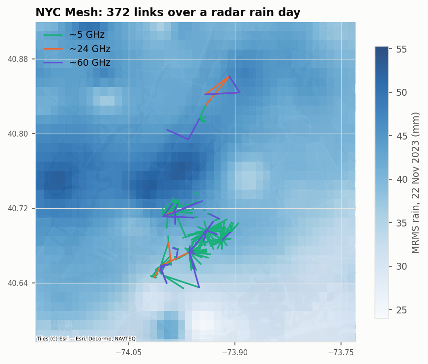

# OpenMesh v2

*The main networks of the OISAC lecture* · `openmesh`

| | |
|---|---|
| Sensor | CML (community mesh) |
| Region | New York City, USA |
| Period | Oct 2023 - Nov 2026, yearly updates |
| Resolution | 1 min, later 6 min |
| Content | 372 links, 758 sub-links of NYC Mesh at 5, 24 and 60 GHz (RSL); ASOS, GHCN, METAR, MRMS radar days |
| Operator / source | NYC Mesh (community network) |
| Licence | CC BY 4.0 |
| Paper | Jacoby et al. (2026), ESSD 18, 5817-5836, [doi:10.5194/essd-18-5817-2026](https://doi.org/10.5194/essd-18-5817-2026) |
| Data | [https://doi.org/10.5281/zenodo.23283445](https://doi.org/10.5281/zenodo.23283445) |

**Links:** [code](https://github.com/drorjac/OpenMesh)



*Drawn from the downloaded split by `python -m oisac_datasets figures`.*

## Get it

```bash
python -m oisac_datasets fetch openmesh            # the small split below
python -m oisac_datasets fetch openmesh --all      # the whole record
```

Split: README, link metadata, station lists, GHCN daily, the radar-event table and one radar day from inside the 606 MB release zip (read over HTTP; the 120 MB link file and the 471 MB ASOS file stay remote).

## Files in the record

| file | size |
|---|---:|
| `openmesh-2.0.0.zip` | 605.7 MB |
| **total** | **605.7 MB** |

## Inside `openmesh-2.0.0.zip` (read over HTTP)

49 members, 631.8 MB unpacked; 22 x .nc, 9 x .py, 6 x .csv, 4 x .md, 3 x .ipynb, 2 x (none)
- `openmesh-2.0.0/README.md` (22.1 kB)
- `openmesh-2.0.0/data/links/links_metadata.csv` (60.4 kB)
- `openmesh-2.0.0/data/links/openmesh_links.nc` (120.1 MB)
- `openmesh-2.0.0/data/weather/asos/asos_stations.csv` (403 B)
- `openmesh-2.0.0/data/weather/asos/openmesh_asos.nc` (471.3 MB)
- `openmesh-2.0.0/data/weather/ghcn/ghcn_daily.csv` (1.0 MB)
- `openmesh-2.0.0/data/weather/ghcn/ghcn_stations.csv` (632 B)
- `openmesh-2.0.0/data/weather/metar/openmesh_metar.csv` (29.5 MB)
- `openmesh-2.0.0/data/weather/radar/openmesh_radar_kokx_rain_2023-11-22.nc` (205.6 kB)
- `openmesh-2.0.0/data/weather/radar/openmesh_radar_kokx_rain_2023-12-18.nc` (299.7 kB)
- `openmesh-2.0.0/data/weather/radar/openmesh_radar_kokx_rain_2024-03-10.nc` (241.7 kB)
- `openmesh-2.0.0/data/weather/radar/openmesh_radar_kokx_rain_2024-03-23.nc` (331.3 kB)
- ... 37 more (full list: `_zip_contents.tsv` after a fetch)

## What the split holds

**`openmesh-2.0.0/openmesh-2.0.0/README.md`** (22.1 kB)

```
# OpenMesh: A Continuously Updated Wireless Signal Dataset for Opportunistic Weather Sensing in New York City

**Signal levels of 372 NYC Mesh links at 5 GHz, 24 GHz and in the 60 GHz band (carriers 58–69 GHz), with NOAA rain references.**
**2023-10-29 → 2026-11-01.** Version 2.0.0. Continuously updated: new data are added about once a year, each time
as a new version of this record; [doi:10.5281/zenodo.23283444](https://doi.org/10.5281/zenodo.23283444) always
points to the latest version (changes in `docs/CHANGELOG.md`).
```

**`openmesh-2.0.0/openmesh-2.0.0/data/links/links_metadata.csv`** (60.4 kB)

```
cml_id,sublink_id,site_0_lat,site_0_lon,site_1_lat,site_1_lon,frequency,length,polarization,direction
1,sublink_1,40.711104,-74.001272,40.724868,-73.987881,69120.0,1901.6,vertical,A
1,sublink_3,40.711104,-74.001272,40.724868,-73.987881,5305.0,1901.6,vertical,A
1,sublink_4,40.724868,-73.987881,40.711104,-74.001272,5305.0,1901.6,vertical,B
2,sublink_1,40.727545,-73.946151,40.715577,-73.984434,69120.0,3489.9,vertical,A
2,sublink_2,40.715577,-73.984434,40.727545,-73.946151,69120.0,3489.9,vertical,B
```

**`openmesh-2.0.0/openmesh-2.0.0/data/weather/asos/asos_stations.csv`** (403 B)

```
Station ID,Latitude,Longitude,Elevation,Description
EWR,40.6925,-74.1687,2.0,"Newark Liberty International Airport (KEWR), NJ ASOS"
JFK,40.6386,-73.7622,7.0,"John F. Kennedy International Airport (KJFK), NY ASOS"
LGA,40.7794,-73.8803,9.0,"LaGuardia Airport (KLGA), NY ASOS"
NYC,40.779,-73.969,27.0,"New York City, Central Park (KNYC), NY ASOS"
TEB,40.85,-74.0608,2.0,"Teterboro Airport (KTEB), NJ ASOS"
```

**`openmesh-2.0.0/openmesh-2.0.0/data/weather/ghcn/ghcn_daily.csv`** (1.0 MB)

```
date,ghcn_id,asos_id,network,day_start_utc,day_end_utc,day_ends,precipitation_mm,snowfall_mm,snow_depth_mm,tmax_c,tmin_c,prcp_mflag,prcp_qflag,prcp_sflag,snow_m
2023-10-29,US1NJBG0018,,CoCoRaHS,2023-10-28 11:00,2023-10-29 11:00,"07:00 local time (assumed, CoCoRaHS protocol)",3.0,0.0,0.0,,,,,N,,,N,,,N,
2023-10-30,US1NJBG0018,,CoCoRaHS,2023-10-29 11:00,2023-10-30 11:00,"07:00 local time (assumed, CoCoRaHS protocol)",28.2,0.0,0.0,,,,,N,,,N,,,N,
2023-10-31,US1NJBG0018,,CoCoRaHS,2023-10-30 11:00,2023-10-31 11:00,"07:00 local time (assumed, CoCoRaHS protocol)",0.0,0.0,0.0,,,T,,N,,,N,,,N,
2023-11-01,US1NJBG0018,,CoCoRaHS,2023-10-31 11:00,2023-11-01 11:00,"07:00 local time (assumed, CoCoRaHS protocol)",0.8,0.0,0.0,,,,,N,,,N,,,N,
2023-11-02,US1NJBG0018,,CoCoRaHS,2023-11-01 11:00,2023-11-02 11:00,"07:00 local time (assumed, CoCoRaHS protocol)",0.0,0.0,0.0,,,,,N,,,N,,,N,
```

**`openmesh-2.0.0/openmesh-2.0.0/data/weather/ghcn/ghcn_stations.csv`** (632 B)

```
ghcn_id,asos_id,network,name,lat,lon,elev
US1NJBG0018,,CoCoRaHS,"PALISADES PARK 0.2 WNW, NJ US",40.848094,-74.000247,21.3
US1NJHD0023,,CoCoRaHS,"JERSEY CITY 1.6 NNE, NJ US",40.73255,-74.05098,30.2
US1NYQN0033,,CoCoRaHS,"HOWARD BEACH 0.4 NNW, NY US",40.662099,-73.841345,2.1
USW00014732,LGA,NWS first-order,"LAGUARDIA AIRPORT, NY US",40.77945,-73.88027,3.0
USW00014734,EWR,NWS first-order,"NEWARK LIBERTY INTERNATIONAL AIRPORT, NJ US",40.68275,-74.16927,1.9
```

**`openmesh-2.0.0/openmesh-2.0.0/data/weather/radar/openmesh_radar_rain_2023-11-22.nc`** (160.0 kB)

- dims: time_1h=24, lat=45, lon=59, time_15min=96, time_10min=145
- `rainfall_amount_1h` ('time_1h', 'lat', 'lon') mm - 1-h gauge-corrected radar QPE (MRMS MultiSensor Pass2), accumulation ending at the stamp
- `rainfall_amount_15min` ('time_15min', 'lat', 'lon') mm - 15-min radar-only QPE (MRMS), accumulation ending at the stamp
- `precip_flag` ('time_10min', 'lat', 'lon') 1 - MRMS surface precipitation type: -3 no coverage, 0 none, 1 warm stratiform rain, 3 snow, 6 convective rain, 7 rain mixed with hail, 10 cold stratiform rain, 91 tropical/stratiform rain mix, 96 tropical/convective mix
- `crs` ()

**`openmesh-2.0.0/openmesh-2.0.0/data/weather/radar/radar_events.csv`** (3.1 kB)

```
file,kind,day,asos_median_mm,rain_share,snow_share,radar_mean_mm,radar_max_mm,lat_min,lat_max,lon_min,lon_max,grid_deg,n_lat,n_lon,products,kokx_file,kokx_produ
openmesh_radar_rain_2023-11-22.nc,rain,2023-11-22,39.12,0.933,0.005,38.3,55.3,40.485,40.925,-74.265,-73.685,0.01,45,59,MultiSensor_QPE_01H_Pass2 (1 h); RadarOnl
openmesh_radar_rain_2023-12-18.nc,rain,2023-12-18,69.34,0.918,0.027,66.4,96.7,40.485,40.925,-74.265,-73.685,0.01,45,59,MultiSensor_QPE_01H_Pass2 (1 h); RadarOnl
openmesh_radar_rain_2024-03-10.nc,rain,2024-03-10,36.07,0.871,0.007,34.3,48.8,40.485,40.925,-74.265,-73.685,0.01,45,59,MultiSensor_QPE_01H_Pass2 (1 h); RadarOnl
openmesh_radar_rain_2024-03-23.nc,rain,2024-03-23,85.85,0.931,0.028,72.0,96.6,40.485,40.925,-74.265,-73.685,0.01,45,59,MultiSensor_QPE_01H_Pass2 (1 h); RadarOnl
openmesh_radar_rain_2025-10-30.nc,rain,2025-10-30,45.97,0.857,0.037,49.5,76.9,40.485,40.925,-74.265,-73.685,0.01,45,59,MultiSensor_QPE_01H_Pass2 (1 h); RadarOnl
```

**`openmesh-2.0.0/openmesh-2.0.0/docs/CHANGELOG.md`** (1.6 kB)

```
# Changelog

## 2.0.0 (2026-10)

First version of the continuously updated OpenMesh record. It continues the 8-month dataset of the ESSD paper
(doi:10.5281/zenodo.15287692), which stays unchanged.
```

**`openmesh-2.0.0/openmesh-2.0.0/tools/README.md`** (3.1 kB)

```
# OpenMesh tools

Read and inspect the **OpenMesh** dataset: NYC Mesh link signal levels at 5 GHz, 24 GHz and in the 60 GHz band (58–69 GHz), NOAA ASOS and GHCN gauges,
and NOAA MRMS and KOKX radar days. The code is MIT-licensed (`LICENSE`); for the data in the folder above see its `docs/LICENSE.md` (NYC Mesh links CC BY 4.0,
NOAA data public domain, CoCoRaHS CC BY 4.0).

```

