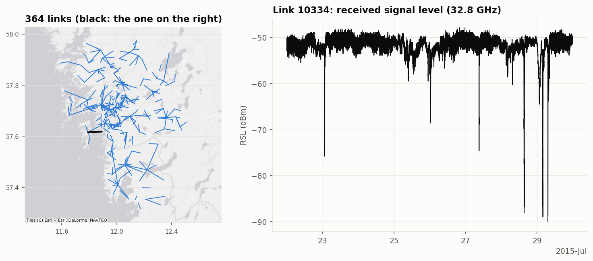

# OpenMRG

*The main networks of the OISAC lecture* · `openmrg`

| | |
|---|---|
| Sensor | CML |
| Region | Gothenburg, Sweden |
| Period | Jun-Aug 2015 |
| Resolution | 10 s |
| Content | 364 CMLs (728 sub-links, 7-38 GHz), TSL and RSL; 11 city gauges, SMHI gauge, SMHI radar |
| Operator / source | Ericsson |
| Licence | CC BY-SA 4.0 |
| Paper | Andersson et al. (2022), ESSD 14, 5411-5426, [doi:10.5194/essd-14-5411-2022](https://doi.org/10.5194/essd-14-5411-2022) |
| Data | [https://doi.org/10.5281/zenodo.7107689](https://doi.org/10.5281/zenodo.7107689) |

**Links:** [example data](https://github.com/OpenSenseAction/opensense_example_data/tree/main/OpenMRG) · [notebook](https://github.com/OpenSenseAction/OPENSENSE_sandbox/blob/main/notebooks/openMRG_use_case.ipynb)



*Drawn from the downloaded split by `python -m oisac_datasets figures`.*

## Get it

```bash
python -m oisac_datasets fetch openmrg            # the small split below
python -m oisac_datasets fetch openmrg --all      # the whole record
```

Split: readme and metadata from inside the 318 MB zip (read over HTTP; the 4.6 GB cml.nc stays remote), plus the OpenSense 8-day example subset (CML, city gauges, radar).

## Files in the record

| file | size |
|---|---:|
| `OpenMRG.zip` | 318.0 MB |
| **total** | **318.0 MB** |

## Inside `OpenMRG.zip` (read over HTTP)

12 members, 4.8 GB unpacked; 5 x .csv, 2 x .nc, 2 x .py, 1 x .txt, 1 x .zip, 1 x .mp4
- `cml/cml.nc` (4.6 GB)
- `cml/cml_metadata.csv` (59.0 kB)
- `cml/example_read_cml.nc.py` (2.0 kB)
- `gauges/city/CityGauges-2015JJA.csv` (5.6 MB)
- `gauges/city/CityGauges-metadata.csv` (729 B)
- `gauges/smhi/GbgA-71420-2015JJA.csv` (553.1 kB)
- `gauges/smhi/GbgA-71420-metadata.csv` (1.3 kB)
- `radar/example_read_radar_nc.py` (1.1 kB)
- `radar/radar.nc` (189.9 MB)
- `readme.txt` (5.3 kB)
- `Torslanda-event-2015-07-28/Torslanda-interactive-time-series.zip` (2.3 MB)
- `Torslanda-event-2015-07-28/Torslanda-radar-animation.mp4` (706.4 kB)

## What the split holds

**`OpenMRG/cml/cml_metadata.csv`** (59.0 kB)

```
Link,Direction,Sublink,NearLatitude_DecDeg,NearLongitude_DecDeg,FarLatitude_DecDeg,FarLongitude_DecDeg,Frequency_GHz,Polarization,Length_km,NearAntennaDiameter_
10001,A,195,57.70368,11.99507,57.69785,11.9911,28.2065,Vertical,0.69144,0.3,0.3
10001,B,194,57.69785,11.9911,57.70368,11.99507,29.2145,Vertical,0.69144,0.3,0.3
10002,A,253,57.72539,11.98181,57.72285,11.97265,38.528,Vertical,0.61455,0.2,0.2
10002,B,254,57.72285,11.97265,57.72539,11.98181,37.268,Vertical,0.61455,0.2,0.2
10003,A,209,57.69247,11.97496,57.69406,11.97951,38.528,Vertical,0.32374,0.3,0.3
```

**`OpenMRG/gauges/city/CityGauges-metadata.csv`** (729 B)

```
Name,Location,Longitude_DecDeg,Latitude_DecDeg,Type,Unit,Resolution (mm)
Jarn,Järnbrottsmotet,11.943145,57.646067,Weighing,millimetre,0.1
Torp,Torpagatan,12.035572,57.718613,Weighing,millimetre,0.1
Bergsj,Bergsjön,12.073303,57.751128,Weighing,millimetre,0.1
Torsl,Torslanda flygpl,11.785332,57.712069,Weighing,millimetre,0.1
Chalm,Chalmers,11.98083,57.683236,Weighing,millimetre,0.1
```

**`OpenMRG/gauges/smhi/GbgA-71420-2015JJA.csv`** (553.1 kB)

```
Time_UTC,Pvol_mm,Pvol_QC,Ta_C,Ta_QC,RH_%,RH_QC,Pmsl_hPa,Pmsl_QC,Vmean_m/s,Vmean_QC,Vdir_deg,Vdir_QC,Vg_m/s,Vg_QC
2015-06-01T00:15:00Z,1,G,NA,NA,NA,NA,NA,NA,NA,NA,NA,NA,NA,NA
2015-06-01T00:30:00Z,0.6,G,NA,NA,NA,NA,NA,NA,NA,NA,NA,NA,NA,NA
2015-06-01T00:45:00Z,0.5,G,NA,NA,NA,NA,NA,NA,NA,NA,NA,NA,NA,NA
2015-06-01T01:00:00Z,0.6,G,12.9,G,93,G,998.6,G,4.9,G,200,G,12.2,G
2015-06-01T01:15:00Z,1.1,G,NA,NA,NA,NA,NA,NA,NA,NA,NA,NA,NA,NA
```

**`OpenMRG/readme.txt`** (5.3 kB)

```
-------
The OpenMRG data set
-------
Version: 1.1
DOI: https://doi.org/10.5281/zenodo.6673750
Licence: https://creativecommons.org/licenses/by-sa/4.0
```

**`example/openmrg_cml_8d.nc`** (26.9 MB)

- dims: time=69120, sublink_id=2, cml_id=364
- time: 2015-07-22T00:00:00 .. 2015-07-29T23:59:50
- `tsl` ('time', 'sublink_id', 'cml_id') dBm - transmitted_signal_level
- `rsl` ('time', 'sublink_id', 'cml_id') dBm - received_signal_level
- `R` ('sublink_id', 'cml_id', 'time')
- coords: site_0_lat, site_0_lon, site_1_lat, site_1_lon, frequency, polarization, length

**`example/openmrg_municp_gauge_8d.nc`** (128.9 kB)

- dims: id=10, time=11520
- time: 2015-07-22T00:00:00 .. 2015-07-29T23:59:00
- `rainfall_amount` ('id', 'time')
- coords: lon, lat, location, type, quantization

**`example/openmrg_rad_8d.nc`** (1.3 MB)

- dims: time=2304, y=48, x=37
- time: 2015-07-22T00:00:00 .. 2015-07-29T23:55:00
- `crs` ()  - CRS definition
- `R` ('time', 'y', 'x') mm/h - rain rate
- coords: lat, lon

