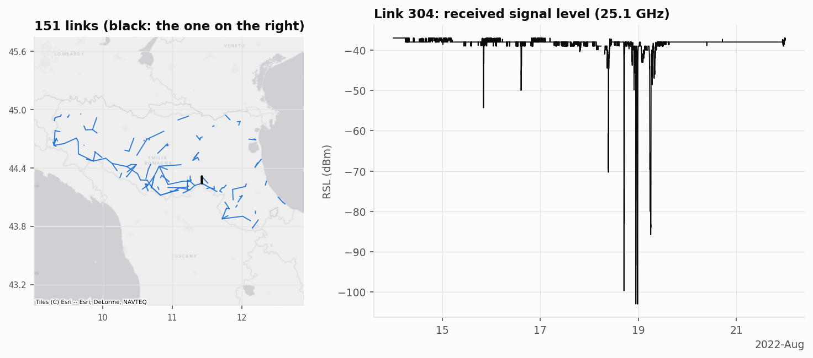

# OpenRainER

*The six networks of the OISAC lecture* · `openrainer`

| | |
|---|---|
| Sensor | CML |
| Region | Emilia-Romagna, Italy |
| Period | 2021-2022 |
| Resolution | 1 min |
| Content | 151 CMLs at 24.6/25.6 GHz (TSL and RSL); 319 ARPAE gauges (15 min); 3 radar products |
| Operator / source | Lepida |
| Licence | CC BY 4.0 |
| Paper | Covi et al. (2026), ESSD Discuss., [doi:10.5194/essd-2026-160](https://doi.org/10.5194/essd-2026-160) |
| Data | [https://doi.org/10.5281/zenodo.10593848](https://doi.org/10.5281/zenodo.10593848) |

**Links:** [example data](https://github.com/OpenSenseAction/opensense_example_data/tree/main/OpenRainER)



*Drawn from the downloaded split by `python -m oisac_datasets figures`.*

## Get it

```bash
python -m oisac_datasets fetch openrainer            # the small split below
python -m oisac_datasets fetch openrainer --all      # the whole record
```

Split: the record README and the OpenSense 8-day example subset (links and gauges; the 16 MB radar subset is left out).

## Files in the record

| file | size |
|---|---:|
| `README.txt` | 7.3 kB |
| `AWS.tar` | 22.2 MB |
| `RADadj.tar` | 1.6 GB |
| `RADrain.tar` | 1.3 GB |
| `RADref.tar` | 1.6 GB |
| `CML.tar` | 107.2 MB |
| **total** | **4.6 GB** |

The DOI now resolves to Zenodo record 22829808 (a newer version); the tool follows it.

## What the split holds

**`README.txt`** (7.3 kB)

```
----------------------
  OpenRainER Dataset
----------------------

Published:      2024-02-02 (Version 1.0)
Last edited:    2026-09-18 (Version 2.0.3)
```

**`example/openrainer_cml_8d.nc`** (829.1 kB)

- dims: cml_id=151, sublink_id=2, time=11412
- time: 2022-08-14T00:00:00 .. 2022-08-21T23:59:00
- `rsl` ('cml_id', 'sublink_id', 'time') dBm - received_signal_level
- `tsl` ('cml_id', 'sublink_id', 'time') dBm - transmitted_signal_level
- coords: length, site_0_lat, site_0_lon, site_0_elev, site_1_lat, site_1_lon, site_1_elev, frequency, polarization

**`example/openrainer_gauges_8d.nc`** (126.8 kB)

- dims: id=319, time=768
- time: 2022-08-14T00:00:00 .. 2022-08-21T23:45:00
- `rainfall_amount` ('id', 'time') mm - 15min_accumulated_rainfall
- coords: lat, lon, elevation

