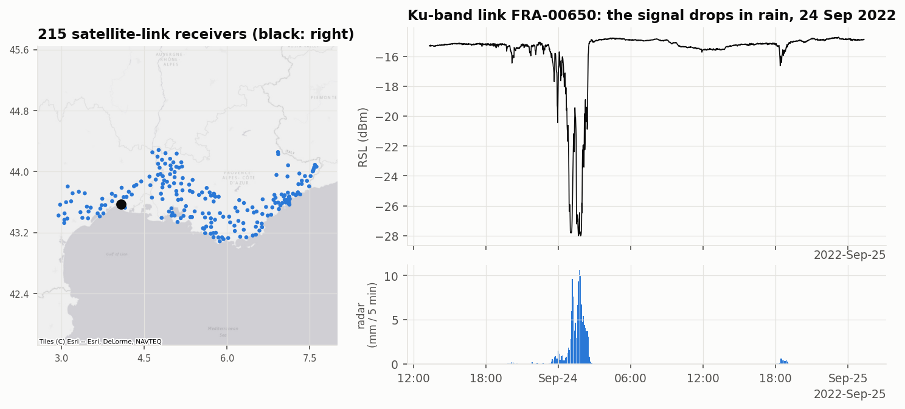

# OpenSat4Weather

*The main networks of the OISAC lecture* · `opensat4weather`

| | |
|---|---|
| Sensor | SML |
| Region | southern France |
| Period | Aug-Dec 2022 |
| Resolution | 1 min |
| Content | 215 Ku-band TV satellite links (RSL) with the ERA5 0 C height; 113 Meteo-France gauges and radar along each link |
| Operator / source | Sereno / HD Rain |
| Licence | CC BY 4.0 |
| Paper | Nebuloni et al. (2026), ESSD 18, 7455-7473, [doi:10.5194/essd-18-7455-2026](https://doi.org/10.5194/essd-18-7455-2026) |
| Data | [https://doi.org/10.5281/zenodo.16530166](https://doi.org/10.5281/zenodo.16530166) |



*Drawn from the downloaded split by `python -m oisac_datasets figures`.*

## Get it

```bash
python -m oisac_datasets fetch opensat4weather            # the small split below
python -m oisac_datasets fetch opensat4weather --all      # the whole record
```

Split: the whole record (42 MB).

## Files in the record

| file | size |
|---|---:|
| `OpenSat4Weather_data.zip` | 41.7 MB |
| **total** | **41.7 MB** |

The DOI now resolves to Zenodo record 16530167 (a newer version); the tool follows it.

## What the split holds

**`OpenSat4Weather_data.zip`** (41.7 MB)

- 4 files, 77.9 MB unpacked; 3 x .nc, 1 x .txt
- `sml_data_2022.nc` (42.7 MB)
- `radar_along_sml_data_2022.nc` (1.7 MB)
- `readme.txt` (2.9 kB)
- `rg_data_2022.nc` (33.5 MB)

*inside:* `radar_along_sml_data_2022.nc`

- dims: time=44064, sml_id=215
- time: 2022-08-01T00:00:00 .. 2022-12-31T23:55:00
- `rainfall_amount` ('time', 'sml_id') mm - rainfall amount along the SML path per time unit

*inside:* `rg_data_2022.nc`

- dims: id=113, time=36721
- time: 2022-08-01T00:00:00 .. 2023-01-01T00:00:00
- `rainfall_amount` ('id', 'time') mm - rainfall_amount_per_time_unit
- coords: lat, lon, elev, location

*inside:* `sml_data_2022.nc`

- dims: sml_id=215, time=220320
- time: 2022-08-01T00:00:00 .. 2022-12-31T23:59:00
- `rsl` ('sml_id', 'time') dBm - received_signal_level
- `deg0l` ('sml_id', 'time') m - Geometric height of 0 degrees C atmospheric isothermal level above ground
- coords: site_0_lat, site_0_lon, site_0_alt, satellite_azimuth, satellite_elevation, satellite, hardware

