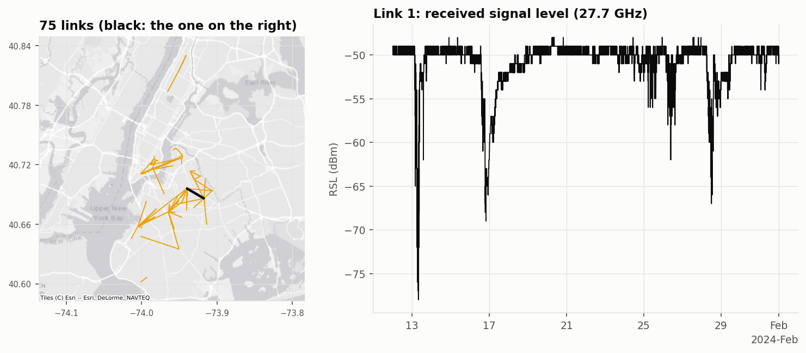

# OpenSense example data

*Example data shipped with software* · `opensense_example`

| | |
|---|---|
| Sensor | CML, PWS, gauges, radar |
| Region | Gothenburg, Emilia-Romagna, Amsterdam, New York City |
| Period | 8-20 day subsets |
| Resolution | as in the source sets |
| Content | short subsets of OpenMRG, OpenRainER, Amsterdam PWS and OpenMesh, converted to the OpenSense data format; used by poligrain, pycomlink and mergeplg |
| Licence | as in the source sets |
| Data | [https://github.com/OpenSenseAction/opensense_example_data](https://github.com/OpenSenseAction/opensense_example_data) |



*Drawn from the downloaded split by `python -m oisac_datasets figures`.*

## Get it

```bash
python -m oisac_datasets fetch opensense_example            # the small split below
python -m oisac_datasets fetch opensense_example --all      # the whole record
```

Split: the OpenMesh 20-day links and ASOS subsets (the other subsets come with their own datasets above).

Source: <https://github.com/OpenSenseAction/opensense_example_data>

## What the split holds

**`example/openmesh_asos_ws_20d.nc`** (3.7 MB)

- dims: id=4, time=28266
- time: 2024-01-12T00:00:00 .. 2024-01-31T23:59:00
- `rainfall_amount` ('id', 'time') mm - 1-min precipitation amount reported as rainfall; may include non-rainfall precipitation (e.g. snow)
- `rainfall_rate` ('id', 'time') mm/hr - Precipitation rate (calculated); may include non-rainfall precipitation (e.g. snow)
- `temperature` ('id', 'time') °C - Air temperature
- `wind_speed` ('id', 'time') m/s - Wind speed
- coords: lat, lon, elev

**`example/openmesh_cml_20d.nc`** (908.7 kB)

- dims: cml_id=75, sublink_id=3, time=28801
- time: 2024-01-12T00:00:00 .. 2024-02-01T00:00:00
- `rsl` ('cml_id', 'sublink_id', 'time') dBm - received_signal_level
- coords: site_0_lat, site_0_lon, site_1_lat, site_1_lon, length, frequency, polarization

