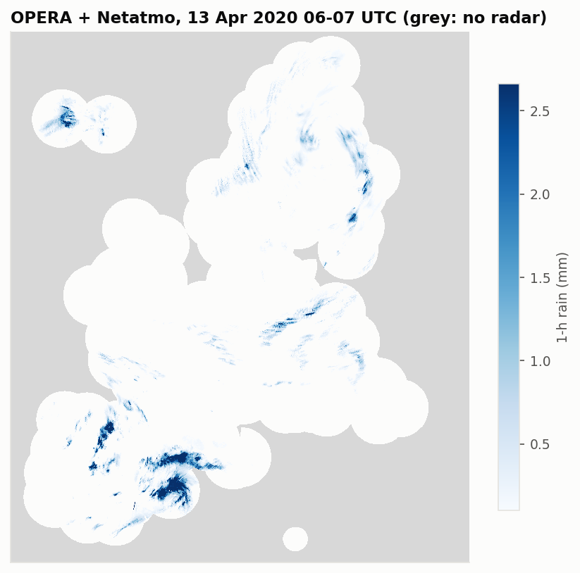

# OPERA radar adjusted with Netatmo PWS

*Rain products from opportunistic sensors* · `opera_netatmo`

| | |
|---|---|
| Sensor | PWS + radar product |
| Region | Europe (78% of its area) |
| Period | Sep 2019 - Aug 2020 |
| Resolution | 1 h |
| Content | pan-European 1-h OPERA radar accumulations adjusted with quality-controlled Netatmo gauges, every clock hour for a year |
| Operator / source | Netatmo (citizens), OPERA (EUMETNET) |
| Licence | CC BY 4.0 |
| Paper | Overeem et al. (2024), HESS 28, 649-668, [doi:10.5194/hess-28-649-2024](https://doi.org/10.5194/hess-28-649-2024) |
| Data | [https://doi.org/10.4121/675f3f64-04a8-48db-ae3e-4a6c004a0776.v2](https://doi.org/10.4121/675f3f64-04a8-48db-ae3e-4a6c004a0776.v2) |



*Drawn from the downloaded split by `python -m oisac_datasets figures`.*

## Get it

```bash
python -m oisac_datasets fetch opera_netatmo            # the small split below
python -m oisac_datasets fetch opera_netatmo --all      # the whole record
```

Split: the README and one hourly map (13 Apr 2020, 07 UTC) from inside a 1.3 GB monthly zip (read over HTTP).

## Files in the record

| file | size |
|---|---:|
| `README` | 3.6 kB |
| `RAD_OPERA_HOURLY_RAINFALL_ACCUMULATION_NETATMO_201912.zip` | 2.1 GB |
| `RAD_OPERA_HOURLY_RAINFALL_ACCUMULATION_NETATMO_202004.zip` | 1.3 GB |
| `RAD_OPERA_HOURLY_RAINFALL_ACCUMULATION_NETATMO_202008.zip` | 1.4 GB |
| `RAD_OPERA_HOURLY_RAINFALL_ACCUMULATION_NETATMO_201911.zip` | 2.3 GB |
| `RAD_OPERA_HOURLY_RAINFALL_ACCUMULATION_NETATMO_202003.zip` | 1.7 GB |
| `RAD_OPERA_HOURLY_RAINFALL_ACCUMULATION_NETATMO_202007.zip` | 1.6 GB |
| `RAD_OPERA_HOURLY_RAINFALL_ACCUMULATION_NETATMO_202002.zip` | 2.0 GB |
| `RAD_OPERA_HOURLY_RAINFALL_ACCUMULATION_NETATMO_202006.zip` | 1.7 GB |
| `RAD_OPERA_HOURLY_RAINFALL_ACCUMULATION_NETATMO_201910.zip` | 2.0 GB |
| `RAD_OPERA_HOURLY_RAINFALL_ACCUMULATION_NETATMO_202005.zip` | 1.5 GB |
| `RAD_OPERA_HOURLY_RAINFALL_ACCUMULATION_NETATMO_202001.zip` | 1.6 GB |
| `RAD_OPERA_HOURLY_RAINFALL_ACCUMULATION_NETATMO_201909.zip` | 1.6 GB |
| **total** | **20.8 GB** |

## Inside `RAD_OPERA_HOURLY_RAINFALL_ACCUMULATION_NETATMO_202004.zip` (read over HTTP)

720 members, 1.3 GB unpacked; 720 x .h5
- `RAD_OPERA_HOURLY_RAINFALL_ACCUMULATION_NETATMO/2020/04/RAD_OPERA_HOURLY_RAINFALL_ACCUMULATION_202004161000.h5` (1.5 MB)
- `RAD_OPERA_HOURLY_RAINFALL_ACCUMULATION_NETATMO/2020/04/RAD_OPERA_HOURLY_RAINFALL_ACCUMULATION_202004130700.h5` (3.0 MB)
- `RAD_OPERA_HOURLY_RAINFALL_ACCUMULATION_NETATMO/2020/04/RAD_OPERA_HOURLY_RAINFALL_ACCUMULATION_202004061900.h5` (2.0 MB)
- `RAD_OPERA_HOURLY_RAINFALL_ACCUMULATION_NETATMO/2020/04/RAD_OPERA_HOURLY_RAINFALL_ACCUMULATION_202004232200.h5` (746.3 kB)
- `RAD_OPERA_HOURLY_RAINFALL_ACCUMULATION_NETATMO/2020/04/RAD_OPERA_HOURLY_RAINFALL_ACCUMULATION_202004100700.h5` (1.2 MB)
- `RAD_OPERA_HOURLY_RAINFALL_ACCUMULATION_NETATMO/2020/04/RAD_OPERA_HOURLY_RAINFALL_ACCUMULATION_202004110400.h5` (1.1 MB)
- `RAD_OPERA_HOURLY_RAINFALL_ACCUMULATION_NETATMO/2020/04/RAD_OPERA_HOURLY_RAINFALL_ACCUMULATION_202004271100.h5` (2.8 MB)
- `RAD_OPERA_HOURLY_RAINFALL_ACCUMULATION_NETATMO/2020/04/RAD_OPERA_HOURLY_RAINFALL_ACCUMULATION_202004030200.h5` (1.2 MB)
- `RAD_OPERA_HOURLY_RAINFALL_ACCUMULATION_NETATMO/2020/04/RAD_OPERA_HOURLY_RAINFALL_ACCUMULATION_202004150100.h5` (2.1 MB)
- `RAD_OPERA_HOURLY_RAINFALL_ACCUMULATION_NETATMO/2020/04/RAD_OPERA_HOURLY_RAINFALL_ACCUMULATION_202004130400.h5` (3.3 MB)
- `RAD_OPERA_HOURLY_RAINFALL_ACCUMULATION_NETATMO/2020/04/RAD_OPERA_HOURLY_RAINFALL_ACCUMULATION_202004231600.h5` (588.3 kB)
- `RAD_OPERA_HOURLY_RAINFALL_ACCUMULATION_NETATMO/2020/04/RAD_OPERA_HOURLY_RAINFALL_ACCUMULATION_202004071400.h5` (1.4 MB)
- ... 708 more (full list: `_zip_contents.tsv` after a fetch)

## What the split holds

**`RAD_OPERA_HOURLY_RAINFALL_ACCUMULATION_NETATMO_202004/RAD_OPERA_HOURLY_RAINFALL_ACCUMULATION_NETATMO/2020/04/RAD_OPERA_HOURLY_RAINFALL_ACCUMULATION_202004130700.h5`** (3.0 MB)

- `dataset1/data1/data` (2200, 1900) float64
- `dataset2/data1/data` (2200, 1900) float64
- what: date=20200413, object=COMP, source=ORG:247, time=070000, version=H5rad 2.0
- where: LL_lat=31.746215319325056, LL_lon=-10.434576838640398, LR_lat=31.98765027794496, LR_lon=29.421038635578032, UL_lat=67.02283275830867, UL_lon=-39.5357864125034, UR_lat=67.62103710275053, UR_lon=57.81196475014995
- dataset1/what: enddate=20200413, endtime=070500, gain=1.0, nodata=-9999000.0, offset=0.0, product=COMP, quantity=ACRR, startdate=20200413

**`README`** (3.6 kB)

