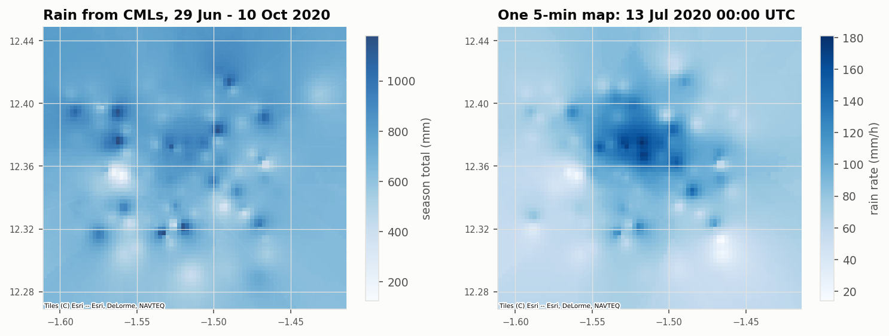

# Ouagadougou CML rain maps

*Rain products from opportunistic sensors* · `ouagadougou`

| | |
|---|---|
| Sensor | CML product (maps) |
| Region | Ouagadougou, Burkina Faso |
| Period | Jun-Oct 2020 |
| Resolution | 5 min, 0.55 km grid |
| Content | rain-rate maps (72 x 79 grid) from the CMLs of a city in West Africa, one rainy season |
| Licence | CC BY 4.0 |
| Paper | Djibo et al. (2023), J. Hydrometeorol. |
| Data | [https://doi.org/10.5281/zenodo.8032918](https://doi.org/10.5281/zenodo.8032918) |



*Drawn from the downloaded split by `python -m oisac_datasets figures`.*

## Get it

```bash
python -m oisac_datasets fetch ouagadougou            # the small split below
python -m oisac_datasets fetch ouagadougou --all      # the whole record
```

Split: the whole map file (28 MB).

## Files in the record

| file | size |
|---|---:|
| `Animation_2020-08-21.mp4` | 1.2 MB |
| `CML_rainfall_maps_Ougadougou.nc` | 28.2 MB |
| **total** | **29.3 MB** |

## What the split holds

**`CML_rainfall_maps_Ougadougou.nc`** (28.2 MB)

- dims: x=72, y=79, time=29665
- time: 2020-06-29T06:05:00 .. 2020-10-10T06:05:00
- `rain_rate` ('x', 'y', 'time')
- coords: longitude, latitude

