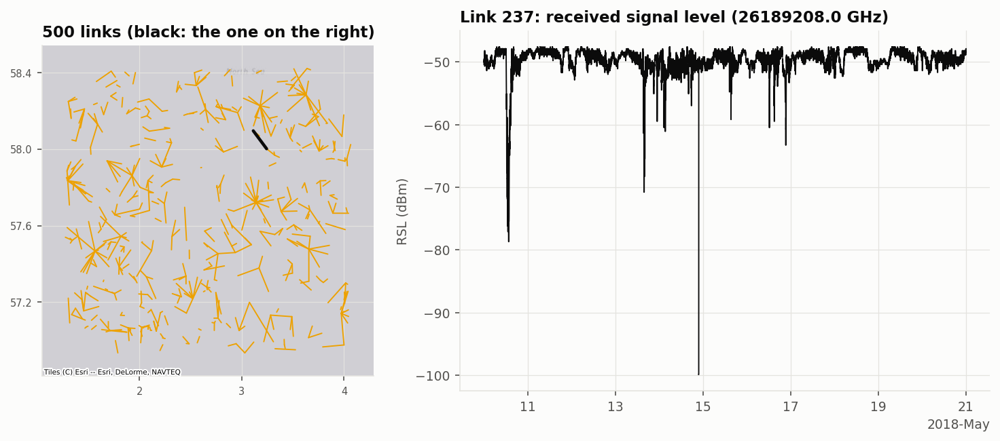

# pycomlink example data

*Example data shipped with software* · `pycomlink_example`

| | |
|---|---|
| Sensor | CML |
| Region | Germany |
| Period | example days |
| Resolution | 1 min |
| Content | 75 German CMLs with path-averaged and gridded radar reference, as used in the pycomlink tutorials |
| Operator / source | Ericsson (via KIT) |
| Licence | BSD-3-Clause (repository) |
| Paper | Chwala et al., pycomlink |
| Data | [https://github.com/pycomlink/pycomlink/tree/master/pycomlink/io/example_data](https://github.com/pycomlink/pycomlink/tree/master/pycomlink/io/example_data) |

**Links:** [tutorials](https://github.com/pycomlink/pycomlink/tree/master/docs/notebooks)



*Drawn from the downloaded split by `python -m oisac_datasets figures`.*

## Get it

```bash
python -m oisac_datasets fetch pycomlink_example            # the small split below
python -m oisac_datasets fetch pycomlink_example --all      # the whole record
```

Split: the example CML file and its path-averaged radar reference.

Source: <https://github.com/pycomlink/pycomlink/tree/master/pycomlink/io/example_data>

## What the split holds

**`example/example_cml_data.nc`** (5.5 MB)

- dims: channel_id=2, cml_id=500, time=15840
- time: 2018-05-10T00:00:00 .. 2018-05-20T23:59:00
- `rsl` ('channel_id', 'cml_id', 'time')
- `tsl` ('channel_id', 'cml_id', 'time')
- coords: length, site_a_latitude, site_a_longitude, site_b_latitude, site_b_longitude, frequency, polarization

**`example/example_path_averaged_reference_data.nc`** (2.4 MB)

- dims: time=3168, cml_id=500
- time: 2018-05-10T00:00:00 .. 2018-05-20T23:55:00
- `rainfall_amount` ('time', 'cml_id')

