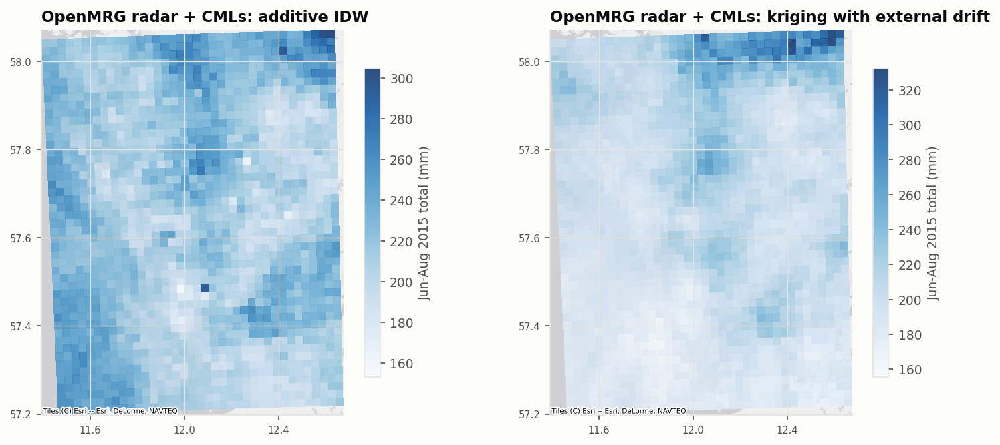

# Radar merged with CMLs (OpenMRG, OpenRainER)

*Rain products from opportunistic sensors* · `radar_cml_merged`

| | |
|---|---|
| Sensor | CML + radar product |
| Region | Gothenburg, Sweden and Emilia-Romagna, Italy |
| Period | summer 2015 and summer 2022 |
| Resolution | 1 h, 1-2 km grid |
| Content | hourly radar rain fields merged with CML data by eight methods, for OpenMRG (48 x 37) and OpenRainER (290 x 373) |
| Licence | CC BY-SA 4.0 |
| Paper | Oydvin et al. (2026), HESS |
| Data | [https://doi.org/10.5281/zenodo.23367571](https://doi.org/10.5281/zenodo.23367571) |

**Links:** [code](https://github.com/OpenSenseAction/radar_adjustment_intercomparison)



*Drawn from the downloaded split by `python -m oisac_datasets figures`.*

## Get it

```bash
python -m oisac_datasets fetch radar_cml_merged            # the small split below
python -m oisac_datasets fetch radar_cml_merged --all      # the whole record
```

Split: two OpenMRG fields (additive IDW and kriging with external drift), 5 MB each.

## Files in the record

| file | size |
|---|---:|
| `OpenMRG_rainfall_add_lBK.nc` | 5.2 MB |
| `OpenMRG_rainfall_lked.nc` | 5.4 MB |
| `OpenMRG_rainfall_add_pBK.nc` | 5.2 MB |
| `OpenMRG_rainfall_mul_IDW.nc` | 5.8 MB |
| `OpenMRG_rainfall_mul_lBK.nc` | 5.8 MB |
| `OpenMRG_rainfall_pked.nc` | 5.4 MB |
| `OpenMRG_rainfall_add_IDW.nc` | 5.1 MB |
| `OpenMRG_rainfall_mul_pBK.nc` | 5.8 MB |
| `OpenRainER_rainfall_add_lBK.nc` | 75.4 MB |
| `OpenRainER_rainfall_add_pBK.nc` | 75.0 MB |
| `OpenRainER_rainfall_mul_IDW.nc` | 90.0 MB |
| `OpenRainER_rainfall_lked.nc` | 84.7 MB |
| `OpenRainER_rainfall_mul_lBK.nc` | 90.1 MB |
| `OpenRainER_rainfall_add_IDW.nc` | 76.8 MB |
| `OpenRainER_rainfall_pked.nc` | 84.7 MB |
| `OpenRainER_rainfall_mul_pBK.nc` | 90.1 MB |
| **total** | **710.4 MB** |

## What the split holds

**`OpenMRG_rainfall_add_IDW.nc`** (5.1 MB)

- dims: time=2207, y=48, x=37
- time: 2015-06-01T01:00:00 .. 2015-08-31T23:00:00
- `rainfall` ('time', 'y', 'x') mm - hourly rainfall accumulation
- coords: lat, lon, x_grid, y_grid

**`OpenMRG_rainfall_pked.nc`** (5.4 MB)

- dims: time=2207, y=48, x=37
- time: 2015-06-01T01:00:00 .. 2015-08-31T23:00:00
- `rainfall` ('time', 'y', 'x') mm - hourly rainfall accumulation
- coords: lat, lon, x_grid, y_grid

