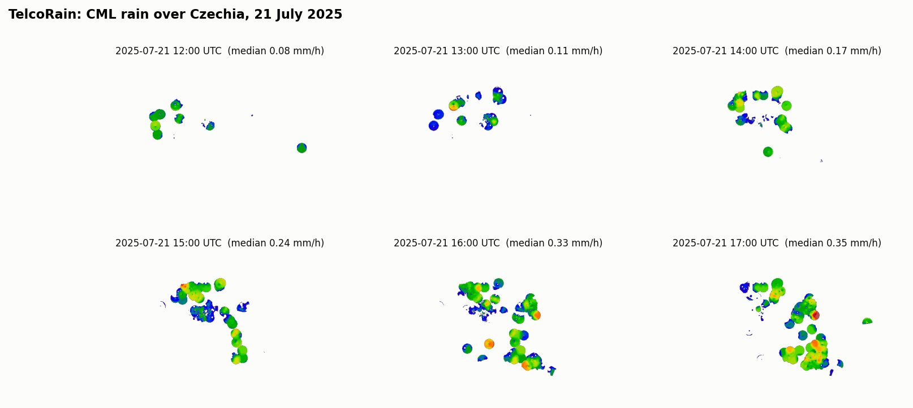

# TelcoRain Czechia rain maps

*Rain products from opportunistic sensors* · `telcorain_cz`

| | |
|---|---|
| Sensor | CML product (images) |
| Region | Czech Republic |
| Period | 2025 |
| Resolution | 10 min |
| Content | country-wide CML rain-intensity images for the whole of 2025 (105 000 PNG frames), from the TelcoRain pipeline |
| Licence | CC BY 4.0 |
| Paper | Istvanek, Musil and Miklanek (2026), Zenodo |
| Data | [https://doi.org/10.5281/zenodo.18349080](https://doi.org/10.5281/zenodo.18349080) |

**Links:** [code](https://github.com/TelcoSense/telcorain) · [live viewer](https://telcosense.cz/rain)



*Drawn from the downloaded split by `python -m oisac_datasets figures`.*

## Get it

```bash
python -m oisac_datasets fetch telcorain_cz            # the small split below
python -m oisac_datasets fetch telcorain_cz --all      # the whole record
```

Split: the afternoon of 21 July 2025, the rainiest day of the year by the frame totals, from inside the 274 MB zip (read over HTTP).

## Files in the record

| file | size |
|---|---:|
| `telcorain_output_2025.zip` | 273.7 MB |
| **total** | **273.7 MB** |

## Inside `telcorain_output_2025.zip` (read over HTTP)

105110 members, 322.6 MB unpacked; 105110 x .png
- `01_telcorain_output/outputs_sum/2025-01-01_0000_0.007.png` (1.8 kB)
- `01_telcorain_output/outputs_sum/2025-01-01_0010_0.007.png` (2.0 kB)
- `01_telcorain_output/outputs_sum/2025-01-01_0020_0.007.png` (2.0 kB)
- `01_telcorain_output/outputs_sum/2025-01-01_0030_0.013.png` (2.9 kB)
- `01_telcorain_output/outputs_sum/2025-01-01_0040_0.013.png` (2.9 kB)
- `01_telcorain_output/outputs_sum/2025-01-01_0050_0.013.png` (2.8 kB)
- `01_telcorain_output/outputs_sum/2025-01-01_0100_0.007.png` (2.1 kB)
- `01_telcorain_output/outputs_sum/2025-01-01_0110_0.007.png` (2.2 kB)
- `01_telcorain_output/outputs_sum/2025-01-01_0120_0.007.png` (2.2 kB)
- `01_telcorain_output/outputs_sum/2025-01-01_0130_0.007.png` (2.2 kB)
- `01_telcorain_output/outputs_sum/2025-01-01_0140_0.007.png` (2.2 kB)
- `01_telcorain_output/outputs_sum/2025-01-01_0150_0.007.png` (2.1 kB)
- ... 105098 more (full list: `_zip_contents.tsv` after a fetch)

## What the split holds

36 files; the first few are described below.

**`telcorain_output_2025/07_telcorain_output/outputs_sum/2025-07-21_1200_0.083.png`** (9.4 kB)

- image 598 x 378 px, mode RGBA

**`telcorain_output_2025/07_telcorain_output/outputs_sum/2025-07-21_1210_0.093.png`** (10.0 kB)

- image 598 x 378 px, mode RGBA

**`telcorain_output_2025/07_telcorain_output/outputs_sum/2025-07-21_1220_0.105.png`** (11.4 kB)

- image 598 x 378 px, mode RGBA

